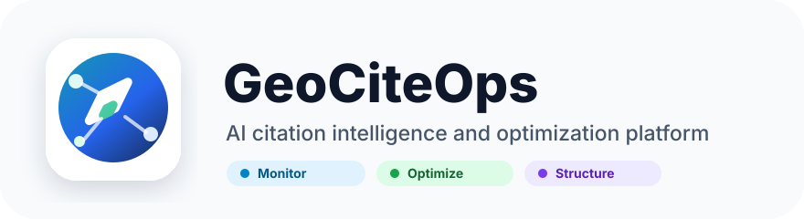
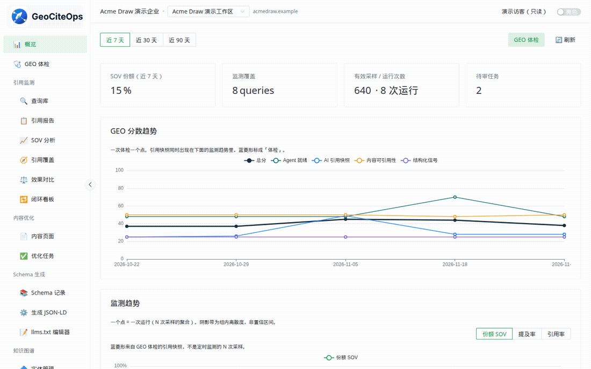
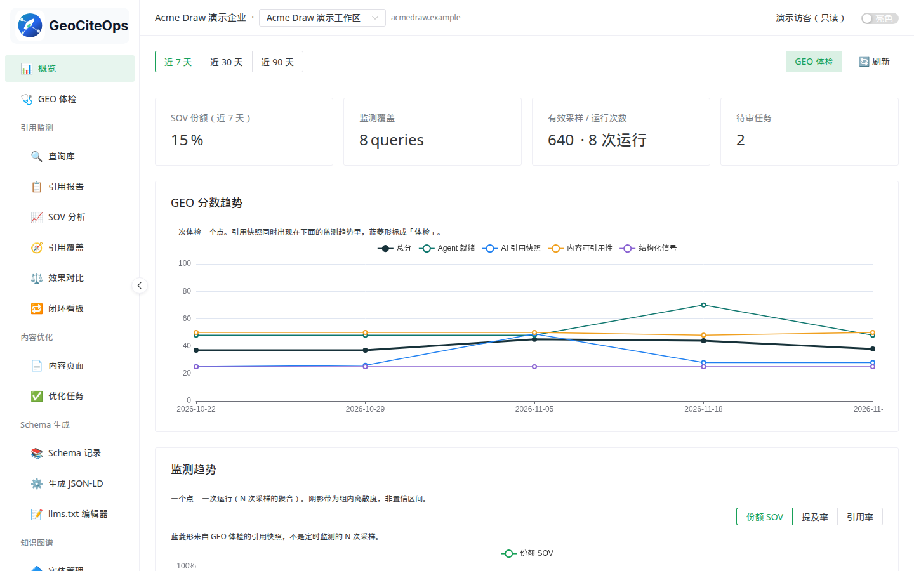
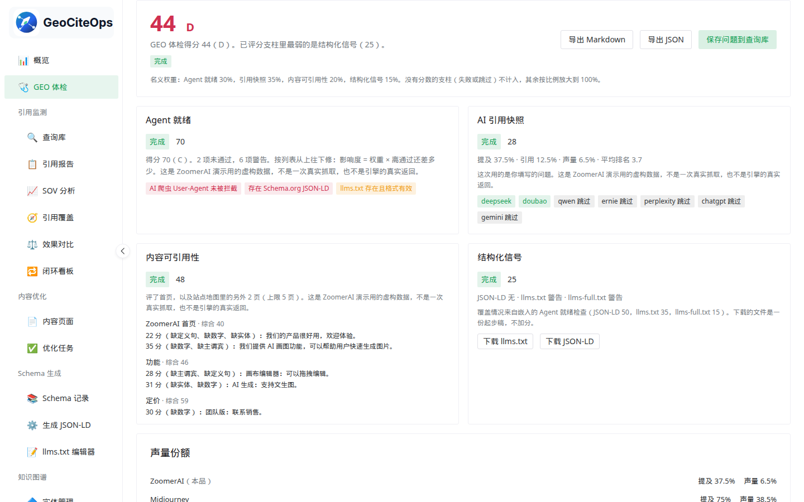
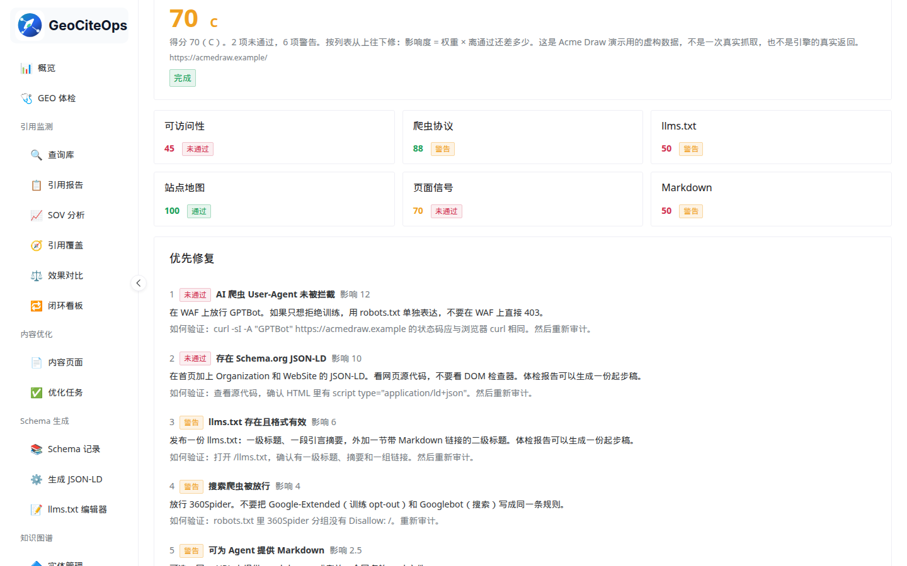
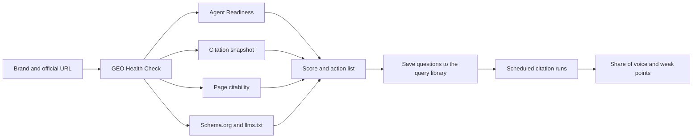

<div align="center">



# GeoCiteOps

**Monitor and improve how AI answer engines cite your brand.**

English · [简体中文](./README.zh-CN.md)

[Five-minute score](#get-your-geo-score-in-5-minutes) · [Demo](#demo) · [How it works](#how-it-works) · [Compare](#compared-with-the-other-ways) · [FAQ](#faq)

[](./LICENSE)
[](https://github.com/letheliu/geociteops/actions/workflows/ci.yml)
[](https://nodejs.org)
[](https://www.typescriptlang.org/)
[](https://www.npmjs.com/package/@geociteops/sdk)
[](https://github.com/letheliu/geociteops/pkgs/container/geociteops-api)

</div>

---

GeoCiteOps is a self-hosted **Generative Engine Optimization (GEO)** platform. GEO is the work of making your pages more likely to be quoted by AI answer engines, the way SEO is the work of being found on a results page.

## Use in Claude Code / Cursor

GeoCiteOps runs inside the editor. `@geociteops/mcp` is the MCP server Claude Code, Cursor, and Claude Desktop call. Agent readiness, `llms.txt`, and JSON-LD work with no API key. Health checks, citation runs, rewrites, and the knowledge graph use your workspace key.

```bash
claude mcp add --transport stdio geociteops \
  --env GEOCITEOPS_API_URL=http://localhost:4000 \
  --env GEOCITEOPS_API_KEY=<workspace-api-key> \
  -- npx -y @geociteops/mcp
```

Copy [integrations/cursor/mcp.json](./integrations/cursor/mcp.json) into Cursor's `.cursor/mcp.json`. To install the Claude Code skill pack from this repo: `claude plugin marketplace add letheliu/geociteops`, then `claude plugin install geociteops@geociteops`. Tools, prompts, and the other client configs are in [docs/mcp.md](./docs/mcp.md).

## Demo

The walkthrough brand is **ZoomerAI**, a fictional AI image product on `zoomer.top`. Nothing in the seed is a live crawl or a live model answer. The scores use the same formulas as a real run (`buildReport`, `conclude`, and the weights in `src/modules/geo-health/weights.ts`). Load it with `pnpm demo:reset`.



| Dashboard | GEO health report | Agent Readiness |
| --- | --- | --- |
| [](./docs/assets/dashboard.webp) | [](./docs/assets/geo-health.webp) | [](./docs/assets/agent-readiness.webp) |

A read-only deployment of this project is at <https://geo.gsgroup.club>. Standing up your own is [docs/DEPLOYMENT.md](./docs/DEPLOYMENT.md).

## Get your GEO score in 5 minutes

The short path is the one-click **GEO Health Check**: one form, one report, a score, and a short action list. You do not configure every engine first.

1. Start the stack. Docker Compose is below. For a local checkout: `pnpm install`, `pnpm db:generate`, then `pnpm dev` (API on port 4000) and `pnpm dev:web` (console on port 5170).
2. Sign in. A fresh database needs a platform admin: `pnpm admin:bootstrap --username admin --password <your-password>`. The password must be at least 10 characters and must not contain the username.
3. Open the workspace and choose **GEO 体检** (`/console/w/:workspaceId/geo-health`).
4. Enter the brand and the official URL. Industry, competitors, and questions are optional. Choose **开始体检**.

Readiness, citability, and structured signals run from the public URL. The citation snapshot only calls engines that already have workspace credentials. The others are skipped and named on the report. Weights, letter grades, and the action sort are written up in [docs/geo-health.md](./docs/geo-health.md).

To open the fictional dataset instead of auditing a real site:

```bash
pnpm demo:reset
```

Sign in as `demo-viewer` (override with `DEMO_USERNAME`). Set `DEMO_ACCOUNT_PASSWORD` before the first reset if you want to choose the password. If it is unset, the script prints one once and does not store it in plaintext. Setting it later does not change an account that already exists. The console lands on the workspace: overview for share of voice, **GEO 体检** for the health report, **Agent 就绪** for the crawler audit. The same reset also stores a separate sample for the fictional brand Acme Draw (`https://acmedraw.example`): four checks, a weekly schedule, and a score chart. Blue diamonds on the share-of-voice chart are those Acme Draw snapshots.

## How it works



A health check is the onboarding pass. Saving its questions turns them into the query library, and the citation monitor keeps sampling on the schedule you set. Content optimization, JSON-LD, `llms.txt`, and the knowledge graph are the follow-up tools on the same workspace. The closed loop (publish a rewrite, then read the next run's delta) is on the loop board.

## Compared with the other ways

Illustrative only. This is how the work is shaped, not a benchmark and not a price survey.

| | By hand | An agency | A closed GEO product | GeoCiteOps |
| --- | --- | --- | --- | --- |
| First look | Paste the same question into each chat and copy the answers into a sheet | A project, then a deck | A dashboard after accounts are connected | One health check on a machine you run |
| The next month | You remember to repeat it | Whatever the retainer includes | Their monitoring, on their definition of share of voice | Scheduled runs. The formulas are in the repo. See [docs/METRICS.md](./docs/METRICS.md) |
| Where the rows live | Your files | Their workspace | Their cloud | Your Postgres |
| What you pay for | Your time | A project fee or a retainer | A subscription | The MIT license. Engine APIs you already use, and the machine this runs on |
| Can you read the score | Yes, if you wrote the sheet | Usually not | Usually not | Yes. Weights and checks are source files |
| Crawler readiness | Read `robots.txt` yourself | Depends on the engagement | Sometimes a separate product | An Agent Readiness audit on the same report |

## What it covers

| Area | What you can do |
| --- | --- |
| GEO health check | One form. Four pillars, at most ten actions, a branded PDF, a daily/weekly/monthly rerun, and the score on a trend chart. The citation snapshot also shows up on the share-of-voice chart, marked as a health check. See [docs/geo-health.md](./docs/geo-health.md). |
| Agent Readiness | Score one public URL for AI crawlers and answer engines: robots.txt per crawler, `llms.txt`, sitemap, page signals, markdown, and whether a bot user-agent is blocked. See [docs/agent-readiness.md](./docs/agent-readiness.md). |
| Citation monitoring | The adapters mounted in `src/server.ts`: DeepSeek, Doubao, Qwen, ERNIE, Perplexity, ChatGPT Search, and Gemini. Share of voice, mention rate, citation rate, rank, and a trend of runs. |
| Content optimization | Atomize a page, score how citable it is, rewrite weak passages, generate FAQ-style answers, and check E-E-A-T. |
| Structured signals | Schema.org JSON-LD (`SoftwareApplication`, `Organization`, `FAQPage`, and others) and `llms.txt`. |
| Knowledge graph | Extract entities and relations. Export JSON or RDF. |
| Tenancy | Organizations, workspaces, envelope-encrypted platform credentials, API keys, and a typed SDK. |

## Architecture

```text
┌──────────────────────────────────────────────────────┐
│ Editors (Claude Code, Cursor, Claude Desktop)        │
│ @geociteops/mcp — stdio, optional local HTTP         │
├──────────────────────────────────────────────────────┤
│ Web Console (Vue 3 + Naive UI + Vite)                │
│ Dashboard · GEO Health · Query Library · Reports     │
│ Content · KG · Agent Readiness                       │
├──────────────────────────────────────────────────────┤
│ API Gateway (Fastify + tRPC)                         │
│ workspace · citation · content · tasks · schema · kg │
│ agentReadiness · geoHealth                           │
├──────────────────────────────────────────────────────┤
│ Core Services                                        │
│ Citation Monitor + Platform Adapters                 │
│ Content Optimizer (atomize → score → rewrite)        │
│ Schema Generator (JSON-LD + llms.txt)                │
│ Agent Readiness (crawler audit + scored report)      │
│ GEO Health Check (one-shot onboarding report)        │
│ Knowledge Graph (entity / relation extraction)       │
│ LLM Provider · Vector Store (Zvec) · Queue (pg-boss) │
├──────────────────────────────────────────────────────┤
│ PostgreSQL + pgvector                                │
└──────────────────────────────────────────────────────┘
```

## Quick Start

### Option A — Docker Compose (recommended)

**Prerequisites:** Docker with the Compose plugin. Nothing else — no local Node, no local PostgreSQL.

```bash
git clone https://github.com/letheliu/geociteops.git
cd geociteops

cp .env.example .env
```

Then edit `.env` and set **two mandatory secrets** — the stack will refuse to start without them:

```bash
# Generate a value for each (run twice, use one result per variable):
node -e "console.log(require('crypto').randomBytes(32).toString('hex'))"
```

| Variable | Why it is mandatory |
| --- | --- |
| `CREDENTIAL_MASTER_KEY` | 64-hex envelope-encryption key for workspace platform credentials. Missing or malformed → startup aborts. |
| `PAY_MOCK_SECRET` | Mock payment callback signing secret. **Fail-closed** (`src/server.ts:109`): missing → the app process terminates on boot, because a default secret is public in source and silently falling back to it would let anyone forge a PAID callback. |

Then bring the stack up:

```bash
docker compose up -d
```

The stack runs four services — `db` (PostgreSQL + pgvector), `migrate` (one-shot `prisma migrate deploy`), `app` (API + all background workers), and `web` (nginx serving the built console). Open **http://localhost:5170/login**.

> Deploying to your own server (demo site, DNS + HTTPS, daily reset cron, ghcr images, npm publish)?
> See [docs/DEPLOYMENT.md](./docs/DEPLOYMENT.md).
>
> How every metric is computed (SOV, weak points, citation attribution tiers, coverage, loop Δ) → [docs/METRICS.md](./docs/METRICS.md).

Create your first platform administrator, then sign in:

```bash
docker compose exec app tsx scripts/admin-bootstrap.ts --username admin --password <your-password>
```

The first sign-in forces a password change, after which you land in the `/admin` back office. From there: create an Organization + Workspace, then click "进入" on the workspace to use the console. The workspace API key is displayed **once** at creation — save it for SDK use.

Persistent data lives in three named volumes, so `docker compose down && docker compose up -d` keeps your database, the vector store (`zvec-data`), and uploaded files (`uploads`).

To load the built-in demo dataset (seed data plus deterministic demo vectors in the vector store):

```bash
docker compose exec app tsx scripts/reset-demo.mjs
```

It prints a read-only demo account password once — keep it, it is not stored in plaintext.

### ⚠️ Session cookies and plain HTTP

The session cookie is named `__Host-geo_sid` by default (`src/platform/identity/cookie.ts`). The `__Host-` prefix **forces `Secure`**, which means browsers reject it over plain HTTP — silently, with no error in the UI: you sign in and land straight back on the login page.

| Deployment | What to do |
| --- | --- |
| `http://localhost:5170` | Works as-is. Browsers treat localhost as a secure context. |
| Bare IP over HTTP, e.g. `http://203.0.113.10:5170` | **Set `GEO_COOKIE_NAME=geo_sid`** in `.env` (drop the `__Host-` prefix), or put the deployment behind HTTPS. |
| HTTPS (e.g. `geo.gsgroup.club`) | Keep the default `__Host-geo_sid` — it is strictly more protective. |

### Option B — Local development with pnpm

**Prerequisites:** Node.js 22.5+ (pnpm 11 uses `node:sqlite`), pnpm 11+, and a PostgreSQL with pgvector you can reach. `package.json` allows Node `>=22`; a 22.0–22.4 install fails at `pnpm install`.

```bash
git clone https://github.com/letheliu/geociteops.git
cd geociteops

pnpm install                       # lockfile is committed — CI and Docker use --frozen-lockfile
cp .env.example .env               # point DATABASE_URL at your own Postgres, set the two secrets above

# Generate the Prisma client. This MUST run before any tsc step:
# the client types (Prisma.InputJsonValue & friends) are produced by `prisma generate`,
# and without them tsc reports 200+ phantom errors.
pnpm db:generate

# Fresh database only — see the upgrade warning below, never db:push an existing one
pnpm db:push

pnpm dev                           # API on http://localhost:4000
pnpm dev:web                       # console on http://localhost:5170 (optional, second terminal)
```

### Platform account and sign-in

The web console no longer offers self-service sign-up: create the first super administrator after deployment, then sign in at `/login`.

```bash
# Create a SUPER_ADMIN (interactive password prompt; or non-interactive: --username admin --password <pw>)
pnpm admin:bootstrap --username admin --password <your-password>
```

Then:

1. Open the web console at `http://localhost:5170/login` and sign in with that account.
2. The first sign-in forces a password change; once completed you land in the `/admin` platform back office.
3. Create an organization + workspace under "Workspace 管理"; the workspace API key is shown **once** on creation — save it for SDK use.
4. Click "进入" on a workspace to use the full console. The "员工账号" page manages platform roles (OPERATOR etc.); all actions are recorded in "审计日志".

### ToB P0 changes at a glance

- **Console access now requires a platform account** (session cookie); public registration/setup routes were removed, and the legacy `localStorage['geo-api-key']` injection is deprecated.
- **The SDK / server-to-server channel is unchanged**: still send the workspace API key via the `x-api-key` header (keys are issued once at workspace creation in `/admin`).
- **`CREDENTIAL_MASTER_KEY` is required** (64-hex): workspace platform credentials are stored with envelope encryption (AES-256-GCM); without it, credential writes and workspace creation fail.
- Demo data seeding: `pnpm tsx scripts/seed-demo.mjs` (requires `CREDENTIAL_MASTER_KEY` in `.env`).

### Upgrading an existing deployment (P0)

> ⚠️ **Never run `pnpm db:push` (or `prisma migrate deploy` from scratch) against an existing database.** The P0 schema drops the `Workspace.apiKeyHash` column; applying it before the carry-over script runs deletes every legacy SDK key **permanently** (the drop is irreversible). Follow the ordered steps below.

Databases created before the ToB P0 migrations must be upgraded in exactly this order:

```bash
# Step 1 — Apply migration A only (identity tables; apiKeyHash still present,
#          organizationId added as nullable). Do NOT let migration B run yet.
npx prisma db execute --file prisma/migrations/20261013124327_tob_p0_identity_tables/migration.sql --schema prisma/schema.prisma
npx prisma migrate resolve --applied 20261013124327_tob_p0_identity_tables

# Step 2 — Carry over data (idempotent, safe to re-run):
#          organization backfill, apiKeyHash → ApiCredential (key hashes unchanged,
#          so existing SDK integrations keep working), platformConfig envelope encryption.
#          Requires CREDENTIAL_MASTER_KEY (64-hex) in .env.
pnpm tsx scripts/migrate-tob-p0.ts

# Step 3 — Apply migration B (tightens Workspace: drops apiKeyHash, organizationId NOT NULL)
npx prisma db execute --file prisma/migrations/20261013133000_tob_p0_tighten_workspace/migration.sql --schema prisma/schema.prisma
npx prisma migrate resolve --applied 20261013133000_tob_p0_tighten_workspace
```

Notes:

- Step 2 is the only moment legacy API keys are carried over; a second run should report `0/0/0` for all three steps (idempotency check).
- `prisma db execute` + `migrate resolve` is used deliberately instead of a single `prisma migrate deploy`, because deploy applies migrations A and B back-to-back and would drop `apiKeyHash` before the carry-over happens. If your environment supports it, you may use `prisma migrate deploy` for step 3 only (after step 2) to apply and record the remaining migration.
- Both migrations end up recorded in `_prisma_migrations`, so future `prisma migrate deploy` runs work normally afterwards.

## ToB P1: organizations and the customer console

P1 turns organizations into real tenants: customer accounts sign in to their own `/console`, and workspace access is decided per membership instead of per platform role.

### P1 changes at a glance

- **Authorization is now split by actor type** (enforced server-side on every request via `x-workspace-id` resolution):
  - Platform staff: `SUPER_ADMIN` reaches every workspace; `OPERATOR` only workspaces assigned to them (assignment lives in the same `WorkspaceMember` table with `access='OPERATE'`); `FINANCE`/`SUPPORT` have no GEO workspace access.
  - Customers: `ORG_OWNER` sees every workspace of their organization; `ORG_MEMBER`/`ORG_VIEWER` only workspaces granted via `WorkspaceMember`, with the effective access being `min(org-role cap, member access)` — an `ORG_VIEWER` is always read-only even when granted `OPERATE`, and a member downgraded to `VIEW` (or removed) is cut off on the very next request of an in-flight session (authorization is resolved live, never cached in the session).
- **New `org.*` API namespace** (customer console backend): org info, member management, per-org workspace management, and API credential issue/revoke — write endpoints require `ORG_OWNER`; cross-organization attempts are rejected before any service is touched.
- **Operator assignment UI** lives in the platform back office: `/admin/workspaces/:id` (WorkspaceDetail) → assign/unassign operators (`isPrimary` marks the responsible consultant).

### Customer sign-in and console pages

1. The platform creates the organization + `ORG_OWNER` account (`pnpm admin:bootstrap` is for platform SUPER_ADMIN only; org owners are provisioned platform-side, e.g. via `createOrgUser`/migration tooling).
2. The owner signs in at `/login` — customer accounts land on `/console` (platform staff still land on `/admin`).
3. `/console` home lists only the workspaces the account is authorized for; switching is one click. Settings offer three pages:
   - **Organization info** — read for everyone; editable by the owner.
   - **Members** — owner creates `ORG_MEMBER`/`ORG_VIEWER` accounts (username auto-generated as `member_<org-prefix>` when not supplied; the initial password is shown once and forces a password change), grants per-workspace access (VIEW/OPERATE), disables accounts, resets passwords.
   - **Credentials (SDK keys)** — owner issues and revokes workspace API keys; the plaintext key is shown exactly once. SDK usage itself is unchanged (`x-api-key` header).

### Consultant assignment (platform side)

`/admin/workspaces/:id` shows and manages the operators assigned to a workspace. Until an `OPERATOR` is assigned, they see no workspaces in `me()` and every `x-workspace-id` request is rejected with `UNAUTHORIZED` — assignment takes effect immediately (same session).

## ToB P2: commerce (catalog, orders, payments, metered entitlements)

P2 completes the commercial loop: service catalog → customer order (amounts and plan snapshot frozen at creation) → payment confirmation (bank-transfer voucher / contract credit / online callback) → asynchronous activation → subscription and quotas in effect → expiry grace and suspension → renewal recovery → refund clawback and manual invoicing.

### Order-to-cash flow

**Customer side (`/console`) — four entries:**

| Page | Purpose |
| --- | --- |
| Marketplace (`/console/services`) | Browse the catalog and place orders (subscription / add-on / professional service); pay via bank transfer, contract credit (opened by the platform), or online payment (WeChat/Alipay QR; mock channels in P2) |
| My orders (`/console/orders`) | Order list and detail: status timeline, voucher upload for bank transfers, refund requests, payee account info |
| My services (`/console/billing`) | Subscription cards (status, period) and quota progress (limits + current-month usage) |
| Invoices (`/console/invoices`) | Request invoices per order; view/download invoice files |

**Platform side (`/admin`) — six entries:**

| Page | Purpose |
| --- | --- |
| Catalog (`/admin/catalog`) | Maintain products and plans (price / billing period / entitlement declarations / delivery milestone templates) |
| Orders (`/admin/orders`) | Full order view, order-on-behalf (price changes require a reason), contract-credit opening (fulfill first, collect later) |
| Order detail (`/admin/orders/:id`) | Status timeline, amounts, voucher and payment transactions |
| Payments (`/admin/payments`) | Bank-transfer voucher queue + contract-credit receivables queue; confirm / reject (FINANCE permission) |
| Refunds (`/admin/refunds`) | Pending approval queue (suggested amount via proration); approve-and-execute (online via channel refund) or reject |
| Invoices (`/admin/invoices`) | Process invoice requests and upload invoice PDFs |

Typical flow: the customer orders in the marketplace → pays by bank transfer (reference = order no.) and uploads the voucher → finance confirms in the payments workbench → the system activates automatically (subscription / delivery record / add-on + entitlement recompute; the first workspace is created if the organization has none) → quotas show up under "My services". Contract-credit orders are opened by an operator in order management (fulfill first, collect later; `dueAt` recorded), with finance confirming later in the receivables queue. Online payments are driven by channel callbacks (idempotent per transaction number), with a 04:30 reconciliation cron as the safety net.

### `BILLING_ENFORCEMENT` rollout order

Once `BILLING_ENFORCEMENT=on`, service-state checks and quota enforcement (§3.3 matrix) apply in full: organizations without an active subscription lose business read/write; expired subscriptions enter a grace period (default 7 days, configurable via `SUBSCRIPTION_GRACE_DAYS`) that is read-only; after grace, all workspaces of the organization are suspended, and renewal restores them automatically. **Gift subscriptions must be granted to existing organizations before flipping the switch** — otherwise existing customers are cut off immediately by "no active service":

```bash
# 1. Commerce table migrations (see "Commerce table migrations" below)
# 2. Grant a 90-day gift subscription to every organization without an active one
#    (idempotent, safe to re-run): the second run should report granted=0 and
#    skipped=<total organizations>
pnpm gift:grant
pnpm gift:grant
# 3. After verifying the results, set BILLING_ENFORCEMENT=on in .env and restart
```

### Payment channel configuration (mock in P2)

| Variable | Required | Purpose |
| --- | --- | --- |
| `PAY_MOCK_SECRET` | yes | Secret for mock WeChat/Alipay callback signature verification (sha256(rawBody+secret)). Fail-closed: the server refuses to start without it — the default secret is public in source, and silently falling back to it would allow forged callbacks to mark orders PAID without payment |
| `PAYMENT_BANK_INFO` | no | Payee account for bank transfers (JSON: `accountName`/`accountNo`/`bankName`). Shown on the customer's order detail when set; otherwise the UI shows "contact your consultant for payment info" |

Real WeChat Pay v3 / Alipay Open Platform SDKs remain a follow-up item (the interface is already isolated: `PaymentChannel`'s createPayment / verifyCallback / queryOrder / refund); implementations will be switched via env with the interface shape unchanged.

### Commerce table migrations (existing deployments)

Follow the same discipline as "Upgrading an existing deployment (P0)" above: **never run `pnpm db:push` against an existing database**. Once the two P0 migrations are recorded, the P2 commerce tables (Product / ProductPlan / Order / OrderItem / OrderEvent / PaymentTransaction / RefundTransaction / Subscription / OrganizationEntitlement / UsageRecord / ServiceDelivery / Invoice) apply through regular incremental migrations:

```bash
npx prisma migrate deploy
```

### Daily billing jobs (cron)

| Job | Time | Purpose |
| --- | --- | --- |
| `order.reconcile` | 04:05 | Reconciliation alert: orders stuck in PAID for >1h (detection net for lost activation jobs) |
| `order.expire` | 04:10 | Auto-cancel orders unpaid for 7 days |
| `subscription.expire-check` | 04:15 | Expiry check: reminder audit for subscriptions ending within 15 days → ACTIVE→GRACE on end → GRACE→EXPIRED with workspace suspension after grace (organization-level aggregation) → orphan restore for "subscription expired" suspensions |
| `payment.reconcile` | 04:30 | Online payment reconciliation: scan WeChat/Alipay PENDING transactions, query the channel, and idempotently back-fill SUCCESS ones by transaction number |

## Configuration

All runtime settings live in `.env`; use [.env.example](./.env.example) as the template.

| Group | Variables |
| --- | --- |
| Database | `DATABASE_URL` |
| Service | `PORT` |
| Internal LLM | `OPENAI_API_KEY`, `OPENAI_BASE_URL`, `EMBEDDING_MODEL`, `CHAT_MODEL` |
| Vector store | `ZVEC_DATA_PATH`, `ZVEC_DIM`, `VECTOR_SIMILARITY_THRESHOLD` |
| Monitored platforms | `DEEPSEEK_*`, `DOUBAO_*`, `QWEN_*`, `ERNIE_*`, `PERPLEXITY_*`, `GEMINI_*`, `OPENAI_SEARCH_MODEL` |
| Matching | `FUZZY_MATCH_THRESHOLD` |
| Platform security | `CREDENTIAL_MASTER_KEY` (required), `CORS_ORIGINS`, `GEO_COOKIE_NAME`, `SESSION_IDLE_PLATFORM_HOURS`, `BILLING_ENFORCEMENT` |
| Commerce & billing (P2) | `PAY_MOCK_SECRET` (required), `PAYMENT_BANK_INFO`, `SUBSCRIPTION_GRACE_DAYS` |

Per-workspace platform credentials are stored in `workspace.platformConfig` with envelope encryption (master key: `CREDENTIAL_MASTER_KEY`) and read by adapters at runtime.

## SDK

```ts
import { createGeoClient } from '@geociteops/sdk'

const geo = createGeoClient({
  serviceUrl: 'http://localhost:4000',
  apiKey: '<your-workspace-api-key>',
})

// Track a query across all configured platforms
const report = await geo.citation.runMonitor.mutate({ queryId: '...' })

// Optimize a content page
const task = await geo.content.optimize.mutate({ pageId: '...' })
```

## Project Structure

```text
src/
├── core/                 # DB, LLM, tRPC, vector store, queue, workspace/auth
├── modules/
│   ├── citation-monitor/ # platform adapters, analyzer, SOV metrics, query library
│   ├── content-optimizer/# atomizer, scoring, rewriter, FAQ, E-E-A-T, orchestrator
│   ├── schema-generator/ # JSON-LD builder, llms.txt builder, validator, registry
│   ├── agent-readiness/  # crawler audit, SSRF-safe fetch, scored report
│   ├── geo-health/       # one-click health check, score, action list
│   └── knowledge-graph/  # extractor, repository, exporter
├── workers/              # citation scheduler, readiness audit, health check (pg-boss)
└── router.ts             # root tRPC router
sdk/                      # typed tRPC client (@geociteops/sdk)
mcp/                      # MCP server for coding agents (@geociteops/mcp)
integrations/claude-code/ # Claude Code plugin and skills
web/                      # Vue 3 console (package name geociteops-web)
prisma/                   # schema.prisma
```

## Testing

```bash
pnpm test
pnpm test:watch
```

## FAQ

<details>
<summary>What is GEO?</summary>

Generative Engine Optimization. The goal is to be mentioned and cited inside an AI answer, not only to rank as a blue link. GeoCiteOps treats that as an operations loop: measure what the engines say, see whether crawlers can fetch the site, and make the pages easier to quote.

</details>

<details>
<summary>Which engines does it call?</summary>

The process in `src/server.ts` registers seven adapters: DeepSeek, Doubao (Volcengine), Qwen, ERNIE, Perplexity, ChatGPT Search, and Gemini. A run only calls the ones whose workspace credentials are set. The health check lists the rest as skipped, with the reason “No credentials configured for this engine.” An Anthropic adapter file exists and is not registered.

</details>

<details>
<summary>Where does the data go? Can I self-host?</summary>

Yes. Docker Compose is the primary install: Postgres, migrations, the API, and the console, on a machine you control. Citation rows, health reports, and credentials stay in that database. Platform credentials are envelope-encrypted with `CREDENTIAL_MASTER_KEY` (AES-256-GCM). Calling an engine sends that engine the question and uses the key you stored. There is no GeoCiteOps cloud account in the open-source build.

</details>

<details>
<summary>What does it cost?</summary>

The repo is MIT. You pay for the computer it runs on and for any engine or LLM API you connect. The health check's readiness, citability, and structured-signal pillars do not need those keys. The citation snapshot and scheduled monitoring do, for each engine you want in the score. Billing inside the app (plans, orders, mock payments) is for people who run GeoCiteOps as a multi-tenant service. It is off unless `BILLING_ENFORCEMENT=on`.

</details>

## Roadmap

- [x] Citation monitoring on the seven registered engines (DeepSeek, Doubao, Qwen, ERNIE, Perplexity, ChatGPT Search, Gemini)
- [x] Content atomization, scoring, and rewriting
- [x] JSON-LD and `llms.txt` generation
- [x] Agent Readiness audit (robots, llms.txt, sitemap, page signals, markdown, bot access)
- [x] One-click GEO health check (readiness + citations + citability + structured signals, PDF, schedule, score trend)
- [x] Knowledge graph extraction and export
- [x] Containerized one-command deployment (Docker Compose, four services)
- [x] MCP server for Claude Code, Cursor, and other clients (`@geociteops/mcp`)
- [x] Closed loop: a weak query → a rewrite suggestion → a human publish → the next run fills in the delta
- [ ] Register the adapters that are not mounted yet, and richer share-of-voice views

## Contributing

Issues and pull requests are welcome. Please open an issue first to discuss large changes. Branch names, commit style, and the test bar are in [CONTRIBUTING.md](./CONTRIBUTING.md). Starter tasks that are not filed as issues yet are listed in [docs/good-first-issues.md](./docs/good-first-issues.md). By contributing, you agree that your contributions are licensed under the MIT License.

## License

[MIT](./LICENSE) © 2026 letheliu
