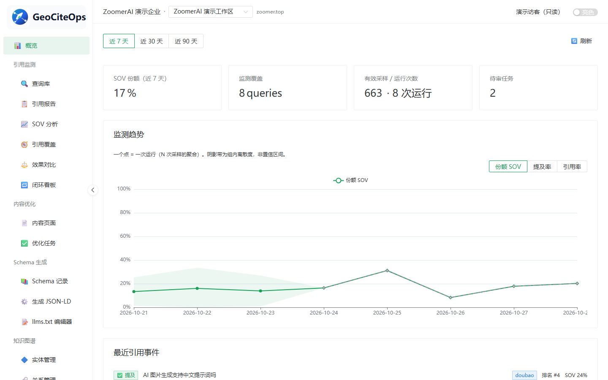
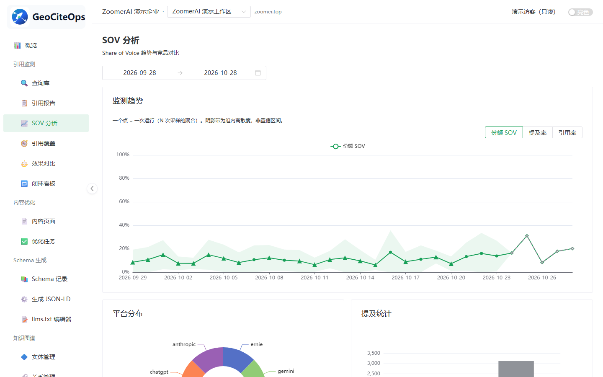
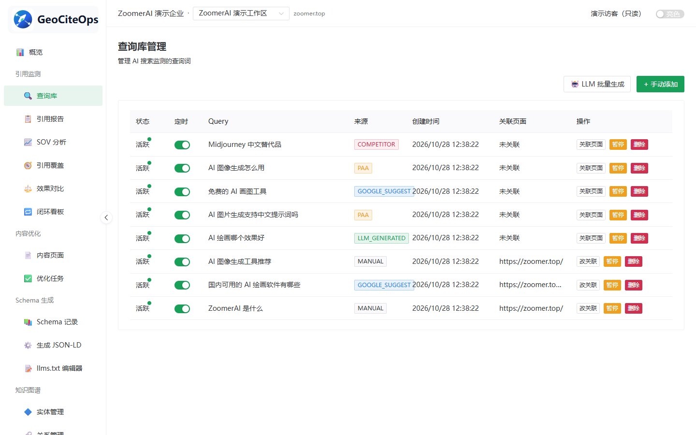
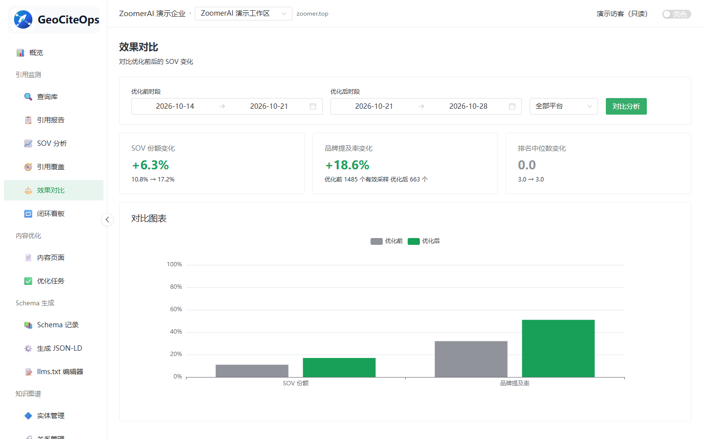
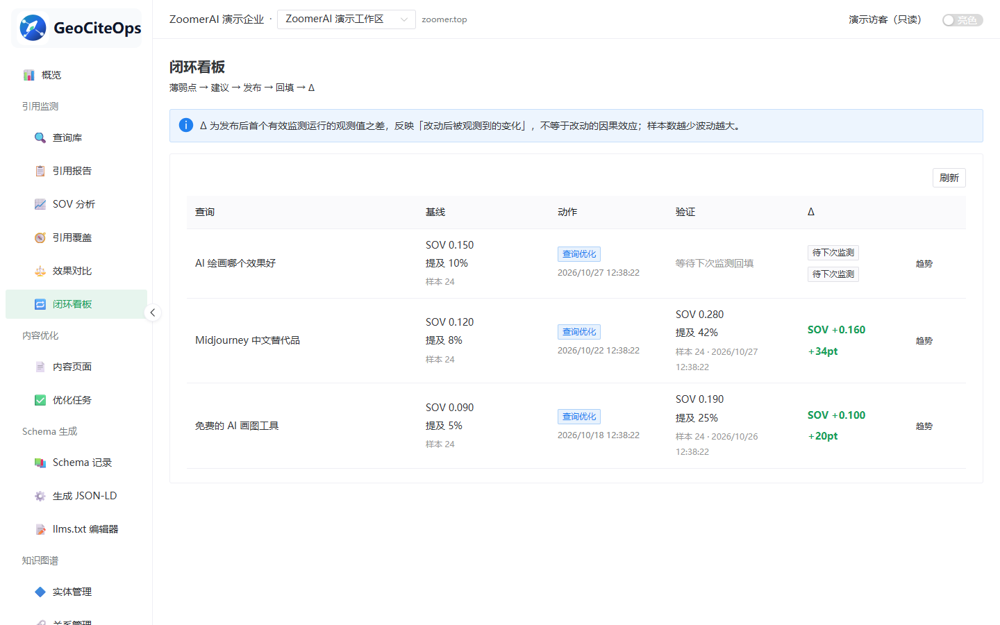
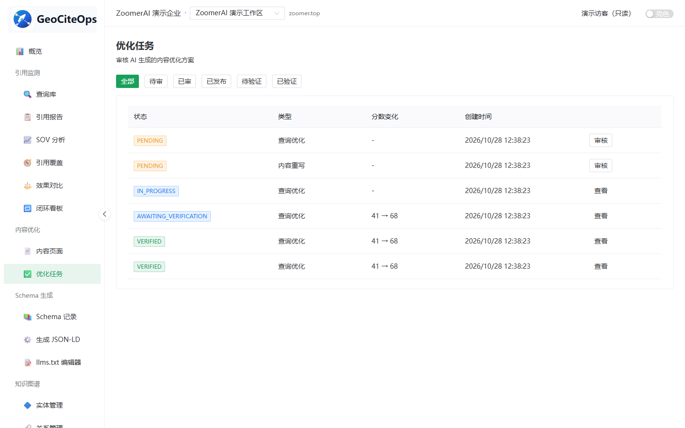
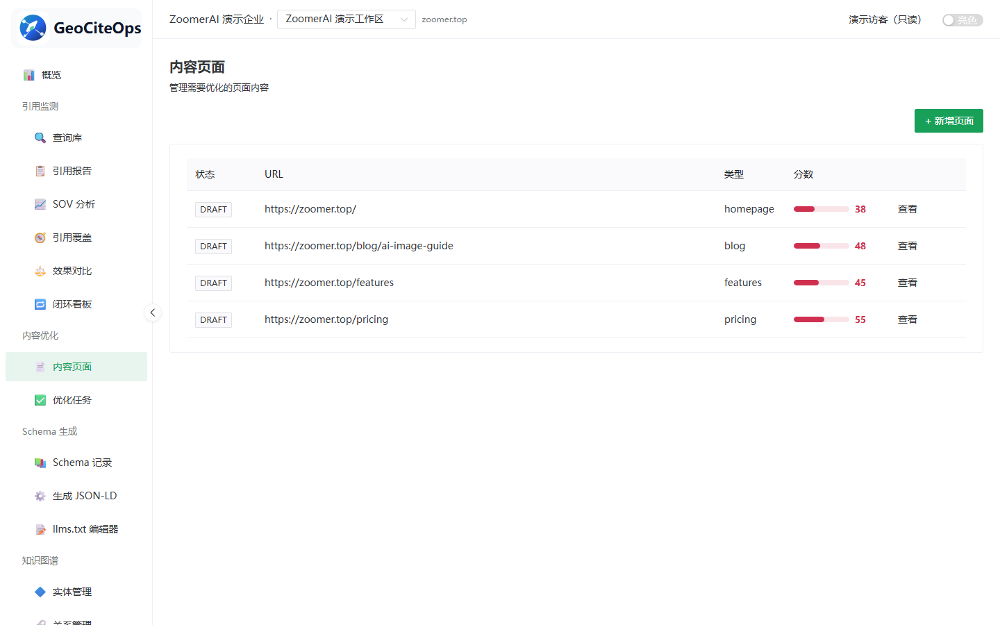
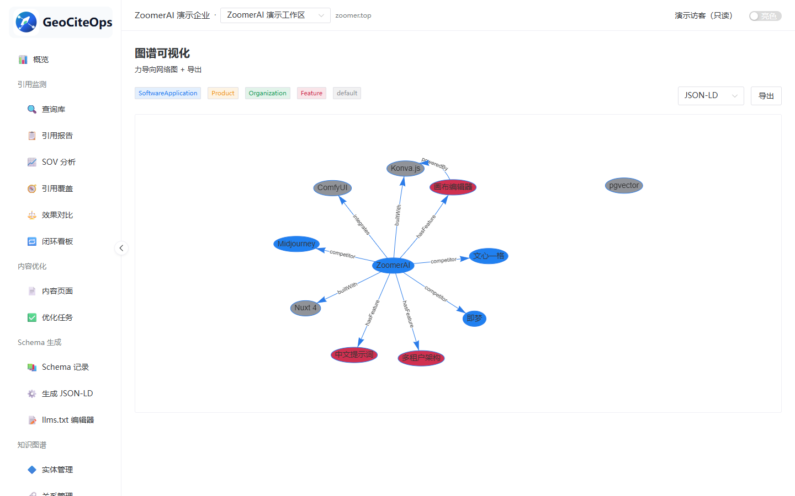

<div align="center">


# GeoCiteOps

**面向生成式搜索的 AI 引用洞察与优化平台。**

追踪 AI 回答引擎如何提及你的品牌，优化它们更容易引用的内容，并输出结构化信号帮助 AI 理解你。

[English](./README.md) · 简体中文

[](./LICENSE)
[](https://github.com/letheliu/geociteops/actions/workflows/ci.yml)
[](https://nodejs.org)
[](https://www.typescriptlang.org/)
[](https://www.npmjs.com/package/@geociteops/sdk)
[](https://github.com/letheliu/geociteops/pkgs/container/geociteops-api)

</div>

---

GeoCiteOps 是一套端到端的**生成式引擎优化（Generative Engine Optimization，GEO）**平台。它帮助团队理解品牌是否被 AI 搜索引擎引用，并通过内容优化、Schema.org、`llms.txt` 与品牌知识图谱形成闭环。

> GEO 优化的是内容被 AI 回答引擎引用的概率，正如 SEO 优化的是网页在搜索结果页中的可见性。

## 截图

以下截图来自内置演示数据集（使用只读演示账号）。

<table>
  <tr>
    <td width="50%" align="center"><br /><sub><b>仪表盘</b> — SOV 趋势、监测覆盖与待审核</sub></td>
    <td width="50%" align="center"><br /><sub><b>SOV 分析</b> — 各 AI 引擎的声音份额与提及统计</sub></td>
  </tr>
  <tr>
    <td width="50%" align="center"><br /><sub><b>查询库</b> — 监测问题、来源与定时配置</sub></td>
    <td width="50%" align="center"><br /><sub><b>效果对比</b> — 优化前后 SOV 与提及率变化</sub></td>
  </tr>
  <tr>
    <td width="50%" align="center"><br /><sub><b>闭环看板</b> — 薄弱查询 → 动作 → 验证 → Δ</sub></td>
    <td width="50%" align="center"><br /><sub><b>优化任务</b> — 审核与发布流水线及分数变化</sub></td>
  </tr>
  <tr>
    <td width="50%" align="center"><br /><sub><b>内容页面</b> — 待优化页面与 GEO 评分</sub></td>
    <td width="50%" align="center"><br /><sub><b>图谱可视化</b> — 实体/关系图与 JSON-LD 导出</sub></td>
  </tr>
</table>

## 为什么需要 GeoCiteOps

| 需求 | GeoCiteOps 提供什么 |
| --- | --- |
| 看清品牌出现在哪里 | 将同一个问题发送到多个主流 AI 引擎，对比品牌提及、引用 URL、排名位置与 SOV（声音份额）。 |
| 让内容更容易被引用 | 将长内容拆成可独立引用的原子单元，逐段评分，改写薄弱段落，并生成 FAQ 风格答案。 |
| 发布机器可读的品牌上下文 | 生成 Schema.org JSON-LD、`llms.txt` 与知识图谱导出，服务 AI 爬虫和下游系统。 |

## 核心能力

| 模块 | 亮点 |
| --- | --- |
| 引用监测 | 适配 DeepSeek、豆包、通义千问、文心一言、ChatGPT Search、Perplexity、Gemini 与 Anthropic/Claude。 |
| 内容优化 | 内容原子化、AI 友好度评分、自动改写、FAQ 生成与 E-E-A-T 校验。 |
| 结构化信号 | 生成 `SoftwareApplication`、`Organization`、`FAQPage` 等 Schema.org JSON-LD，并输出 `llms.txt`。 |
| 知识图谱 | 抽取实体与关系，支持 JSON / RDF 导出。 |
| 多租户运行时 | 工作区隔离、工作区级平台凭证、API Key 与类型化 SDK 访问。 |

## 系统架构

```text
┌──────────────────────────────────────────────────────┐
│ Web 控制台（Vue 3 + Naive UI + Vite）                │
│ 仪表盘 · 查询库 · 引用报告 · 内容优化 · 知识图谱       │
├──────────────────────────────────────────────────────┤
│ API 网关（Fastify + tRPC）                           │
│ workspace · citation · content · tasks · schema · kg │
├──────────────────────────────────────────────────────┤
│ 核心服务                                             │
│ 引用监测器 + 平台适配器                              │
│ 内容优化器（原子化 → 评分 → 改写）                   │
│ Schema 生成器（JSON-LD + llms.txt）                  │
│ 知识图谱（实体 / 关系抽取）                          │
│ LLM Provider · 向量库（Zvec）· 任务队列（pg-boss）   │
├──────────────────────────────────────────────────────┤
│ PostgreSQL + pgvector                                │
└──────────────────────────────────────────────────────┘
```

## 快速开始

### 方式 A：Docker Compose（推荐）

**前置要求：** 装了 Docker 与 Compose 插件即可，本机不需要 Node，也不需要 PostgreSQL。

```bash
git clone https://github.com/letheliu/geociteops.git
cd geociteops

cp .env.example .env
```

然后编辑 `.env`，配置**两个必改密钥**——缺任意一个整栈都起不来：

```bash
# 生成值（执行两次，两个变量各用一个）：
node -e "console.log(require('crypto').randomBytes(32).toString('hex'))"
```

| 变量 | 为什么必填 |
| --- | --- |
| `CREDENTIAL_MASTER_KEY` | 工作区平台凭证的信封加密主密钥（64 位 hex）。缺失或格式非法 → 服务启动即终止。 |
| `PAY_MOCK_SECRET` | mock 支付回调验签密钥，**fail-closed**（`src/server.ts:109`）：缺失 → app 进程启动即终止——默认密钥源码公开，静默回落等于任何人可伪造 PAID 回调。 |

起栈：

```bash
docker compose up -d
```

整栈四个服务：`db`（PostgreSQL + pgvector）、`migrate`（一次性 `prisma migrate deploy`）、`app`（API + 全部后台 worker）、`web`（nginx 托管前端产物）。浏览器打开 **http://localhost:5170/login**。

> 要部署到自己服务器（DNS + HTTPS、每日重置 cron、ghcr 镜像、npm 发布）？
> 见 [docs/DEPLOYMENT.md](./docs/DEPLOYMENT.md)。
>
> 每个指标如何计算（SOV、薄弱点、引用归因分层、覆盖率、闭环 Δ）→ [docs/METRICS.md](./docs/METRICS.md)。

创建首个平台超级管理员后登录：

```bash
docker compose exec app tsx scripts/admin-bootstrap.ts --username admin --password <你的密码>
```

首次登录强制改密，完成后进入 `/admin` 平台后台；在后台新建企业 + Workspace，点列表「进入」即可使用工作台。Workspace API Key 创建时**仅展示一次**，请妥善保存供 SDK 使用。

数据落在三个命名卷里，`docker compose down && docker compose up -d` 之后数据库、向量库（`zvec-data`）、上传文件（`uploads`）都还在。

加载内置演示数据（种子数据 + 向量库中的确定性演示向量）：

```bash
docker compose exec app tsx scripts/reset-demo.mjs
```

它会一次性打印只读演示账号密码——库里不存明文，请自行记录。

### ⚠️ 会话 Cookie 与纯 HTTP

会话 Cookie 默认名为 `__Host-geo_sid`（`src/platform/identity/cookie.ts`）。`__Host-` 前缀**强制 `Secure`**，浏览器在纯 HTTP 下会直接拒收且**不报错**——表现就是「登录后立刻被弹回登录页」。

| 部署形态 | 怎么办 |
| --- | --- |
| `http://localhost:5170` | 保持默认即可，浏览器把 localhost 视为可信上下文。 |
| 裸 IP + 纯 HTTP，如 `http://203.0.113.10:5170` | **必须**在 `.env` 设 `GEO_COOKIE_NAME=geo_sid`（去掉 `__Host-` 前缀），或改走 HTTPS。 |
| HTTPS（如 `geo.example.com`） | 保持默认 `__Host-geo_sid`，保护更强，不要改。 |

### 方式 B：本机 pnpm 开发

**前置要求：** Node.js 20+、pnpm 11+，以及你自己可访问的带 pgvector 的 PostgreSQL。

```bash
git clone https://github.com/letheliu/geociteops.git
cd geociteops

pnpm install                       # 锁文件已纳入版本管理，CI 与 Docker 一律 --frozen-lockfile
cp .env.example .env               # DATABASE_URL 指向你自己的库，并配好上面那两个必填密钥

# 生成 Prisma client。这一步必须在任何 tsc 之前：
# Prisma.InputJsonValue 等类型由 prisma generate 产出，
# 缺了它 tsc 会报 200+ 个假错。
pnpm db:generate

# 仅限全新库——存量库严禁 db:push，见下方升级警告
pnpm db:push

pnpm dev                           # API：http://localhost:4000
pnpm dev:web                       # 控制台：http://localhost:5170（可选，另开终端）
```

### 平台账号与登录

Web 控制台不再开放自助注册：首次部署后需先创建平台超级管理员，再从 `/login` 登录使用。

```bash
# 创建超级管理员（交互式输入密码；或非交互：--username admin --password <pw>）
pnpm admin:bootstrap --username admin --password <你的密码>
```

随后：

1. 打开 Web 控制台 `http://localhost:5170/login`，用该账号登录；
2. 首次登录会被强制跳转修改密码（原密码为 bootstrap 时设置的密码），完成改密后自动进入 `/admin` 平台后台；
3. 在「Workspace 管理」新建企业 + Workspace，创建成功会**一次性展示**该 Workspace 的 API Key（仅此一次，请妥善保存，供 SDK 使用）；
4. 从列表「进入」Workspace 即可使用全部工作台功能；「员工账号」页可维护 OPERATOR 等平台角色，操作记录见「审计日志」。

### ToB P0 变更要点

- **控制台改为平台账号登录**（会话 Cookie），公开注册/初始化路由已下线；旧版通过 `localStorage['geo-api-key']` 注入工作区 Key 的方式已废弃。
- **SDK / 服务端直连通道不变**：仍通过 `x-api-key` 请求头携带 Workspace API Key（Key 在 `/admin` 新建 Workspace 时一次性发放）。
- **`CREDENTIAL_MASTER_KEY` 必配**（64 位 hex）：工作区平台凭证以信封加密（AES-256-GCM）存储，缺失该配置时凭证写入与 Workspace 创建不可用。
- 演示数据填充：`pnpm tsx scripts/seed-demo.mjs`（需 `.env` 配好 `CREDENTIAL_MASTER_KEY`）。

### 存量部署升级（P0）

> ⚠️ **严禁对存量库直接执行 `pnpm db:push`（或从零跑 `prisma migrate deploy`）。** P0 schema 会删除 `Workspace.apiKeyHash` 列；若在平移脚本运行前应用，所有存量 SDK Key 将**永久丢失**（删列不可逆）。必须严格按以下时序升级：

ToB P0 迁移之前创建的数据库，必须按此顺序升级：

```bash
# 步骤 1 —— 只应用迁移 A（建 identity 表；apiKeyHash 仍在，
#           organizationId 以可空列加入）。此时绝不能让迁移 B 先跑。
npx prisma db execute --file prisma/migrations/20261013124327_tob_p0_identity_tables/migration.sql --schema prisma/schema.prisma
npx prisma migrate resolve --applied 20261013124327_tob_p0_identity_tables

# 步骤 2 —— 数据平移（幂等，可重复执行）：
#           组织回填、apiKeyHash → ApiCredential 平移（keyHash 值不变，
#           现有 SDK 集成不中断）、platformConfig 明文信封加密。
#           需 .env 配好 CREDENTIAL_MASTER_KEY（64 位 hex）。
pnpm tsx scripts/migrate-tob-p0.ts

# 步骤 3 —— 应用迁移 B（收紧 Workspace：删 apiKeyHash、organizationId 置 NOT NULL）
npx prisma db execute --file prisma/migrations/20261013133000_tob_p0_tighten_workspace/migration.sql --schema prisma/schema.prisma
npx prisma migrate resolve --applied 20261013133000_tob_p0_tighten_workspace
```

说明：

- 步骤 2 是存量 API Key 唯一的平移时机；脚本第二遍运行三步计数应全为 0（幂等自检）。
- 这里刻意用 `prisma db execute` + `migrate resolve` 而不是一把 `prisma migrate deploy`：deploy 会把迁移 A、B 连续应用，在平移发生前就删掉 `apiKeyHash`。若你的环境支持，可仅对步骤 3 改用 `prisma migrate deploy`（在步骤 2 之后）来应用并记录剩余迁移。
- 两个迁移最终都会记入 `_prisma_migrations`，之后的 `prisma migrate deploy` 可正常增量使用。

## ToB P1：企业与客户控制台

P1 让 Organization 成为真正的租户：客户账号登录自己的 `/console`，Workspace 访问按成员授权判定，不再随平台角色全量放开。

### P1 变更要点

- **授权按主体分治**（服务端每个请求经 `x-workspace-id` 解析强制执行）：
  - 平台侧：`SUPER_ADMIN` 可进一切 Workspace；`OPERATOR` 仅能进**被分配**的 Workspace（分配记录同样落在 `WorkspaceMember` 表，`access='OPERATE'`）；`FINANCE`/`SUPPORT` 不使用 GEO 功能。
  - 客户侧：`ORG_OWNER` 本企业全部 Workspace；`ORG_MEMBER`/`ORG_VIEWER` 仅能进通过 `WorkspaceMember` 授权的 Workspace，最终权限 = min(企业角色上限, 成员授权)——`ORG_VIEWER` 即使被授予 `OPERATE` 也恒只读；成员被降为 `VIEW` 或被移除后，在途会话的**下一个请求**即被拒（授权实时查库，不缓存进会话）。
- **新增 `org.*` 接口命名空间**（客户控制台后端）：企业信息、成员管理、本企业 Workspace 管理、API 凭证签发/吊销——写操作均要求 `ORG_OWNER`；跨企业访问在触达业务服务前即被拒。
- **顾问分配入口**在平台后台：`/admin/workspaces/:id`（WorkspaceDetail）分配/取消分配运营顾问（`isPrimary` 即负责顾问）。

### 客户登录与控制台页面

1. 平台侧创建企业 + `ORG_OWNER` 账号（`pnpm admin:bootstrap` 只建平台 SUPER_ADMIN；企业所有者由平台侧产生，如 `createOrgUser`/迁移工具）。
2. 所有者从 `/login` 登录——客户账号落到 `/console`（平台员工仍落 `/admin`）。
3. `/console` 首页只列出该账号**被授权**的 Workspace，一键切换；设置分三页：
   - **企业信息**：全员可看，所有者可改；
   - **成员管理**：所有者创建 `ORG_MEMBER`/`ORG_VIEWER` 账号（不指定用户名时自动生成 `member_<企业前缀>` 开头；初始密码一次性显示，首登强制改密）、按 Workspace 授权（VIEW/OPERATE）、停用账号、重置密码；
   - **凭证管理（SDK Key）**：所有者签发/吊销 Workspace API Key，明文 Key 仅创建时显示一次；SDK 用法不变（`x-api-key` 请求头）。

### 顾问分配（平台侧）

`/admin/workspaces/:id` 查看并管理该 Workspace 的运营顾问。`OPERATOR` 被分配前 `me()` 工作区列表为空、带 `x-workspace-id` 的请求一律 `UNAUTHORIZED`；分配即时生效（同一会话立即可进）。

## ToB P2：商业化（目录 · 订单 · 收款 · 配额计费）

P2 补齐商业闭环：服务目录 → 客户下单（金额与套餐快照固化）→ 收款确认（对公转账回单 / 合同账期 / 在线支付回调）→ 异步自动开通 → 订阅与配额生效 → 到期宽限/暂停 → 续费恢复 → 退款回收与手工发票。

### 下单到收款全流程

**客户侧（`/console`）四个入口：**

| 页面 | 用途 |
| --- | --- |
| 商城（`/console/services`） | 浏览目录并下单（订阅 / 加购 / 专业服务），可选对公转账、合同账期（由平台开通）或在线支付（微信/支付宝扫码；P2 为 mock 渠道） |
| 我的订单（`/console/orders`） | 订单列表与详情：状态时间线、对公转账回单上传、发起退款、查看收款账户信息 |
| 我的服务（`/console/billing`） | 订阅卡片（状态 / 起止时间）与配额进度（限额 + 当月用量） |
| 发票（`/console/invoices`） | 按订单申请开票、查看/下载发票文件 |

**平台侧（`/admin`）六个入口：**

| 页面 | 用途 |
| --- | --- |
| 服务目录（`/admin/catalog`） | 维护商品与套餐（价格 / 计费周期 / 配额声明 / 交付里程碑模板） |
| 订单管理（`/admin/orders`） | 全量订单视图、代客下单（改价需填原因）、合同账期开通（先开通后收款） |
| 订单详情（`/admin/orders/:id`） | 状态时间线、金额构成、回单与支付流水 |
| 收款工作台（`/admin/payments`） | 对公转账回单待确认队列 + 合同账期应收队列；确认 / 驳回（FINANCE 权限点） |
| 退款工作台（`/admin/refunds`） | 待审批退款队列（建议金额按 proration 计算）、审批执行（线上走渠道退款）/ 驳回 |
| 发票管理（`/admin/invoices`） | 开票请求处理与发票 PDF 上传 |

典型流程：客户在商城下单 → 对公转账（备注订单号）并上传回单 → 财务在收款工作台确认 → 系统自动开通（订阅 / 交付单 / 加购 + 配额重算；企业若无工作区自动创建首个）→ 客户在"我的服务"看到配额生效。合同账期单由运营在订单管理开通（Ruling：先开通后收款，`dueAt` 落库），财务后续在应收队列确认收款。在线支付由渠道回调驱动（同一交易号重复回调幂等），每日 04:30 对账 cron 兜底补单。

### `BILLING_ENFORCEMENT` 上线时序

`BILLING_ENFORCEMENT=on` 后，服务状态判定与配额检查（§3.3 矩阵）全面生效：无有效订阅的企业业务读写被拒；订阅到期进入宽限期（默认 7 天，`SUBSCRIPTION_GRACE_DAYS` 可配）期间只读；宽限满后企业全部工作区暂停，续费自动恢复。**开关打开前必须先为存量企业发放赠送订阅**——否则存量客户会被"无有效服务"立即拦截：

```bash
# 1. 商业表迁移（见下方"商业表迁移"节）
# 2. 为每个"无有效订阅"的存量企业发放 90 天赠送订阅（幂等，可重复执行）：
#    第二遍运行 granted=0、skipped=企业总数 即发放完成
pnpm gift:grant
pnpm gift:grant
# 3. 核对发放结果无误后，把 .env 的 BILLING_ENFORCEMENT 改为 on 并重启服务
```

### 支付渠道配置（P2 为 mock）

| 变量 | 必填 | 说明 |
| --- | --- | --- |
| `PAY_MOCK_SECRET` | 是 | 微信/支付宝 mock 渠道回调验签密钥（sha256(rawBody+secret)）。fail-closed：缺失时服务启动即终止——默认密钥源码公开，静默回落等于可伪造回调签名免付置 PAID |
| `PAYMENT_BANK_INFO` | 否 | 平台对公收款账户（JSON：`accountName`/`accountNo`/`bankName`）。配置后客户在订单详情可见；留空或非法则显示"联系顾问获取收款信息" |

微信支付 v3 / 支付宝开放平台的真实 SDK 对接为遗留项（P2 接口已隔离：`PaymentChannel` 的 createPayment / verifyCallback / queryOrder / refund），届时按 env 切换实现，接口形状不变。

### 商业表迁移（存量部署）

存量库升级沿用上方「存量部署升级（P0）」节的纪律：**严禁对存量库直接 `pnpm db:push`**。P0 两步迁移完成后，P2 商业表（Product / ProductPlan / Order / OrderItem / OrderEvent / PaymentTransaction / RefundTransaction / Subscription / OrganizationEntitlement / UsageRecord / ServiceDelivery / Invoice）走正常增量迁移：

```bash
npx prisma migrate deploy
```

### 每日计费任务（cron）

| 任务 | 时刻 | 用途 |
| --- | --- | --- |
| `order.reconcile` | 04:05 | 对账告警：订单 PAID 停留 >1h（开通任务投递丢失的兜底发现面） |
| `order.expire` | 04:10 | 超时未支付 7 天的订单自动取消 |
| `subscription.expire-check` | 04:15 | 订阅到期检查：15 天内到期留痕提醒 → 到期转宽限 → 宽限满过期并暂停工作区（企业聚合判定）→ "订阅到期"暂停的孤儿恢复 |
| `payment.reconcile` | 04:30 | 线上支付对账：扫描微信/支付宝 PENDING 流水主动查单，SUCCESS 按同交易号幂等补单 |

## 配置说明

所有运行时配置都放在 `.env` 中；请以 [.env.example](./.env.example) 为模板。

| 分组 | 变量 |
| --- | --- |
| 数据库 | `DATABASE_URL` |
| 服务 | `PORT` |
| 内部 LLM | `OPENAI_API_KEY`、`OPENAI_BASE_URL`、`EMBEDDING_MODEL`、`CHAT_MODEL` |
| 向量库 | `ZVEC_DATA_PATH`、`ZVEC_DIM`、`VECTOR_SIMILARITY_THRESHOLD` |
| 被监测平台 | `DEEPSEEK_*`、`DOUBAO_*`、`QWEN_*`、`ERNIE_*`、`PERPLEXITY_*`、`GEMINI_*`、`OPENAI_SEARCH_MODEL` |
| 匹配 | `FUZZY_MATCH_THRESHOLD` |
| 平台安全 | `CREDENTIAL_MASTER_KEY`（必配）、`CORS_ORIGINS`、`GEO_COOKIE_NAME`、`SESSION_IDLE_PLATFORM_HOURS`、`BILLING_ENFORCEMENT` |
| 商业化计费（P2） | `PAY_MOCK_SECRET`（必配）、`PAYMENT_BANK_INFO`、`SUBSCRIPTION_GRACE_DAYS` |

各工作区的平台凭证以信封加密保存在 `workspace.platformConfig`（主密钥为 `CREDENTIAL_MASTER_KEY`），由平台适配器在运行时读取。

## SDK

```ts
import { createGeoClient } from '@geociteops/sdk'

const geo = createGeoClient({
  serviceUrl: 'http://localhost:4000',
  apiKey: '<你的工作区 API Key>',
})

// 跨所有已配置平台追踪某个查询
const report = await geo.citation.runMonitor.mutate({ queryId: '...' })

// 优化某个内容页
const task = await geo.content.optimize.mutate({ pageId: '...' })
```

## 项目结构

```text
src/
├── core/                 # 数据库、LLM、tRPC、向量库、队列、工作区鉴权
├── modules/
│   ├── citation-monitor/ # 平台适配器、分析器、SOV 指标、查询库
│   ├── content-optimizer/# 原子化、评分、改写、FAQ、E-E-A-T、编排器
│   ├── schema-generator/ # JSON-LD 构建器、llms.txt 构建器、校验器、注册表
│   └── knowledge-graph/  # 抽取器、仓储、导出器
├── workers/              # 引用调度器（pg-boss）
└── router.ts             # 根 tRPC 路由
sdk/                      # 类型化 tRPC 客户端（@geociteops/sdk）
web/                      # Vue 3 管理控制台（geo-web）
prisma/                   # schema.prisma
```

## 测试

```bash
pnpm test
pnpm test:watch
```

## 路线图

- [x] 8 个 AI 引擎的引用监测
- [x] 内容原子化、评分与改写
- [x] JSON-LD 与 `llms.txt` 生成
- [x] 知识图谱抽取与导出
- [x] 容器化一键部署（Docker Compose 四服务）
- [ ] 闭环自动化：监测 → 优化建议 → 发布
- [ ] 更多平台与更丰富的 SOV 分析

## 参与贡献

欢迎提交 Issue 和 Pull Request。较大的改动请先开 Issue 讨论——分支命名、commit 风格、新代码的测试要求见 [CONTRIBUTING.md](./CONTRIBUTING.md)。提交贡献即表示你同意以 MIT 协议授权。

## 联系方式

有问题、想反馈 Bug 或洽谈合作，欢迎联系：

- QQ：**395112951**
- 邮箱：**letheliuxin@agent.qq.com**

## 许可证

[MIT](./LICENSE) © 2026 letheliu
